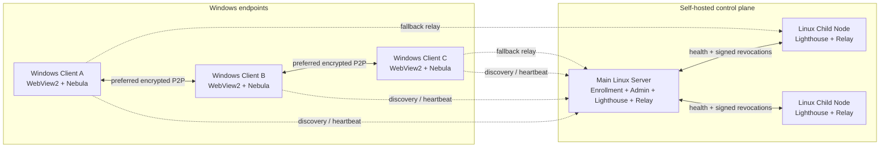

<div align="center">
  
  <h1>MeshLAN</h1>
  <p><a href="README.md">简体中文</a> · <a href="README.en.md">English</a> · <strong>日本語</strong></p>
  <p><strong>P2P を優先し、Relay をフォールバックに使うセルフホスト型仮想 LAN／ローカルサービス共有基盤</strong></p>
  <p>
    
    
    
    
    
  </p>
</div>

MeshLAN は [SlackHQ Nebula](https://github.com/slackhq/nebula) を基盤に、自動ペアリング、
P2P/NAT 最適化、複数 Lighthouse/Relay、TCP/UDP サービスマッピング、MeshDNS、
ファイル直接転送、アクセス承認、リアルタイムトポロジー、履歴、安全な更新、任意の
AI 自動化を統合します。Windows 側はポータブルなネイティブクライアントを実行し、
コントロールプレーンと中継ノードは自分の Linux サーバーで運用します。

> このリポジトリには Windows クライアント、Linux メインサーバー、Linux 子ノードの
> 完全なソースコードが含まれます。スクリーンショットは実際のネイティブクライアント
> から取得し、端末名、IP、IPv6、ドメイン、公開エンドポイントをマスクしています。

## スクリーンショット

### リアルタイムネットワークトポロジー


### 履歴とリプレイ


### AI アシスタント


## 主な機能

- **仮想 LAN：** Nebula v2 証明書と暗号化トンネルで離れた Windows 端末を接続。
- **P2P 優先：** デュアルスタックのホールパンチ、固定 UDP ポート、UPnP、STUN 診断、Route Guard。
- **Relay フォールバック：** 直接接続できない場合だけ自動中継し、品質の良いノードを選択。
- **マルチノード：** Linux 子 Lighthouse/Relay のヘルスチェックとフェイルオーバー。
- **サービスマッピング：** `localhost` の TCP/UDP サービスを Mesh 内へ公開。
- **アクセス承認：** 即時アクセスまたは所有者による個別承認を選択可能。
- **MeshDNS：** `alice.mesh`、`api.alice.mesh` のような安定した名前でアクセス。
- **HTTPS ゲートウェイ：** `.mesh` HTTP サービス向けローカル証明書とポート不要アクセス。
- **ファイル直接転送：** ファイル本体を端末間の暗号化経路で転送。
- **可観測性：** P2P/Relay 経路、Underlay、遅延、トラフィック、サービス状態をリアルタイム表示。
- **ユーザー別 Token 集計：** モデル応答の実 `usage` から入力、出力、キャッシュ、推論 Token を累積し、会話本文は読み取りません。
- **履歴とリプレイ：** ローカル SQLite に通信量、経路、接続、イベントを保存。
- **AI アシスタント：** モデルの認証情報はサーバーに保持し、変更操作には利用者の確認が必須。
- **安全な更新：** Ed25519 署名、SHA-256 検証、ヘルスチェック、自動ロールバック。
- **多言語 UI／AI：** 簡体字中国語、繁体字中国語、英語、日本語を即時切替し、AI の応答も同じ言語に統一して端末内に保存。

## 離れた端末を一つの LAN にする

MeshLAN は単一 API を公開するだけのトンネルではありません。異なる ISP、地域、NAT
配下にある Windows 端末を一つの暗号化 LAN に参加させます。各端末には安定した Mesh
IP が割り当てられ、既存の家庭内／社内ネットワークやデフォルトゲートウェイは変更しません。

- 端末間は暗号化 P2P を優先し、ホールパンチに失敗した場合だけ Relay に切り替えます。
- 端末ごとに IPv4、IPv6、スマートデュアルスタックを選択できます。
- Route Guard がグローバルプロキシや TUN による MeshLAN 経路の横取りを防ぎます。
- トポロジー画面にオンライン端末、実際の P2P/Relay 経路、遅延、通信量を表示します。
- ネットワーク切替や公開エンドポイント変更後は自動的に再登録・再接続します。
- ping、RDP、SMB、データベース、ゲームサーバー、自作 API など既存プロトコルを利用できます。

```text
Windows A ── encrypted P2P ── Windows B
    │                              │
10.77.0.2                      10.77.0.3
    └──── Relay fallback（必要な場合のみ）────┘
```

コントロールサーバーは端末認可、証明書、探索メタデータを管理します。通常の P2P
データは代理転送しません。Relay 使用時も、中継ノードが扱うのは Nebula で暗号化された
パケットだけです。

## MeshDNS：端末とサービスを名前で利用

MeshDNS は各ユーザー／端末に変更可能で一意なプレフィックスを割り当て、現在の端末・
サービス状態からレコードをリアルタイム生成します。各 PC の `hosts` を手作業で編集する
必要はありません。

端末プレフィックスが `alice` の場合：

| 対象 | MeshDNS 名 | 利用例 |
|---|---|---|
| 端末 | `alice.mesh` | ping、RDP、SMB、その他のプロトコル |
| HTTP サービス | `chat.alice.mesh` | ローカルゲートウェイ経由のポート不要アクセス |
| TCP サービス | `db.alice.mesh:5432` | DB、API、独自 TCP プロトコル |
| UDP サービス | `game.alice.mesh:27015` | ゲームサーバー、その他の UDP サービス |

利用者は自分の端末プレフィックスと、公開済みサービスごとの第 3 レベルプレフィックスを
変更できます。マッピングの作成、編集、一時停止、削除に合わせて共有サービス一覧と
MeshDNS レコードが更新されます。名前の競合は保存前に拒否されます。ポートを省略できる
のは HTTP/HTTPS ゲートウェイモードだけで、通常の TCP/UDP はマッピングポートを使います。

## サービスマッピング：localhost をインターネットへ公開せず共有

ローカル API、管理画面、データベース、ゲームサーバーなど、多くの開発用サービスは
`localhost` のみで待ち受けます。MeshLAN はルーターのポート転送や公開リスナーを使わず、
それらを暗号化仮想 LAN 内へ公開します。

マッピング作成時に指定する項目：

1. `Chat API` などのサービス名。
2. `localhost` と `4571` などのローカルホスト／ポート。
3. TCP または UDP。
4. 自動割当または任意の Mesh ポート。
5. `chat` などの MeshDNS サービスプレフィックス。
6. 即時アクセスまたは所有者承認。

同じ Mesh のメンバーは、共有サービス一覧で所有者、名称、プロトコル、ヘルス状態、
アクセス先、ポートをリアルタイム確認できます。例えば `localhost:4571` を次のように
公開できます。

```text
http://chat.alice.mesh
# または通常のポートモード
chat.alice.mesh:20000
```

各ユーザーは複数の TCP/UDP マッピングを同時に公開できます。ポート競合は作成前に
明示されます。所有者はマッピング全体または承認済みユーザー単位で一時停止し、現在の
接続者と通信量を確認して後から再開できます。承認制サービスでは申請メッセージが作成
され、所有者が許可または拒否します。共有一覧は全員が閲覧できますが、編集・削除できる
のは自分が作成したマッピングだけです。

```text
peer request
    │
    ▼
chat.alice.mesh:20000
    │  MeshDNS + access policy
    ▼
alice (10.77.0.2)
    │  local encrypted forwarding
    ▼
localhost:4571
```

## アーキテクチャ



| コンポーネント | プラットフォーム | 役割 |
|---|---|---|
| Windows Client | Windows 10/11 | ネイティブ UI、登録、Nebula サービス、Route Guard、サービスマッピング、MeshDNS、ファイル転送、AI |
| Main Server | Linux amd64/arm64 | 管理画面、端末認可、証明書、失効、更新配信、メイン Lighthouse/Relay、AI Provider |
| Child Node | Linux amd64/arm64 | 追加 Lighthouse/Relay、ヘルス報告、失効同期、フェイルオーバー |

## 技術スタック

| レイヤー | 技術 |
|---|---|
| 言語 | Go 1.26、PowerShell、Bash、Vanilla JavaScript |
| Overlay | SlackHQ Nebula 1.11、Noise ハンドシェイク、v2 証明書、Lighthouse/Relay/Punchy |
| Windows UI | WebView2 ネイティブウィンドウ、埋め込み HTML/CSS/JavaScript、外部 CDN なし |
| 可視化 | SVG トポロジー、リアルタイム通信量、履歴グラフ |
| 永続化 | SQLite WAL、JSON 状態、Windows DPAPI |
| 暗号 | TLS 1.3 pinning、X25519、AES-256-GCM、Ed25519、SHA-256 |
| Windows 連携 | SCM、IP Helper API、WFP、タスクスケジューラ、ルート、証明書ストア |
| Linux 連携 | systemd、`LoadCredential`、ファイル権限、アトミック更新 |
| AI | OpenAI 互換 Chat Completions、SSE ストリーミング、サーバー側ツール許可リスト |
| CI | GitHub Actions による Windows/Linux テスト、vet、マルチプラットフォームビルド |

## リポジトリ構成

```text
.
├── cmd/meshlan/               # MeshLAN 実行プログラムのソース
│   ├── admin/                 # Linux メインサーバー管理画面
│   ├── assets/                # アイコンと Windows manifest
│   ├── deploy/                # Linux 子ノードのスクリプトと systemd 設定
│   ├── web/                   # Windows クライアント UI
│   ├── *_windows.go           # Windows クライアント／OS 連携
│   ├── server.go              # メインサーバーと管理 API
│   ├── node_agent.go          # Linux 子ノード
│   ├── multinode.go           # 複数 Lighthouse/Relay 管理
│   └── ai_*.go                # AI 暗号化、ストリーム、会話、ツール
├── docs/                      # ドキュメントとマスク済み画像
├── tools/                     # 診断スクリプト
├── build.ps1                  # テストとクロスプラットフォームビルド
└── VERSION
```

## クイックスタート

### 必要環境

- Go 1.26+
- クライアントのビルド／実行用 Windows 10/11
- Microsoft Edge WebView2 Runtime
- Nebula と `nebula-cert` 1.11.x
- メインサーバーおよび任意の子ノード用 Linux ホスト

### 全コンポーネントをビルド

```powershell
git clone https://github.com/zhaoxuya520/MeshLAN.git
cd MeshLAN
.\build.ps1
```

成果物は `dist/` に生成されます。

```text
MeshLAN-Nebula-Windows.exe
meshlan-nebula-server-linux-amd64
meshlan-nebula-server-linux-arm64
meshlan-nebula-node-linux-amd64
meshlan-nebula-node-linux-arm64
SHA256SUMS.txt
```

**Windows マシンがなくてもクライアントをビルドできます。** `cmd/meshlan` は純粋な Go で、
既定で `CGO_ENABLED=0` のため、Linux/macOS からクロスコンパイルできます：

```bash
VERSION="$(cat VERSION)"
CGO_ENABLED=0 GOOS=windows GOARCH=amd64 go build -trimpath \
  -ldflags "-s -w -H=windowsgui -X main.clientVersion=meshlan-nebula/$VERSION" \
  -o dist/MeshLAN-Nebula-Windows.exe ./cmd/meshlan
```

生成物は PE32+ / amd64 / **GUI サブシステム**のバイナリ（コンソールアプリではありません）で、
約 15 MB です。

> **このリポジトリは GitHub リリースを一切公開していません**（タグのみ）。`dist/` も
> コミットされません。既成の exe は `build.ps1` か、Actions の成果物（コミット単位で
> ダウンロード可能、期限あり）から得られます。

### メインサーバーを初期化

次の公開アドレス、ポート、パスは実環境に合わせて変更してください。

```bash
sudo install -d -m 0700 /etc/meshlan-nebula
sudo install -m 0755 meshlan-nebula-server-linux-arm64 /usr/local/bin/meshlan-nebula
sudo install -d -m 0755 /dev/net
sudo mknod /dev/net/tun c 10 200 2>/dev/null || true

sudo /usr/local/bin/meshlan-nebula server init \
  -state /etc/meshlan-nebula/server-state.json \
  -endpoint 203.0.113.10:4242 \
  -subnet 10.77.0.0/24 \
  -nebula-port 4242 \
  -pairing-port 8443 \
  -nebula /usr/local/bin/nebula \
  -nebula-cert /usr/local/bin/nebula-cert
```

初期化時にペアリングハッシュと管理トークンが一度だけ表示されます。パスワード管理
ツールに保存した後、systemd で `server serve` を実行してください。設定した Nebula UDP
ポートとペアリング／管理 HTTPS ポートをファイアウォールで許可します。本番環境では
有効なドメイン証明書、専用 systemd ユーザー、`LoadCredential`、最小限の許可ルール、
オフラインバックアップを推奨します。Nebula は tun デバイスを作成するため、`/dev/net/tun` がある
ホストで `server serve` を root（または `CAP_NET_ADMIN` 付き）で実行してください。tun デバイス名は
`meshlan-lh`（15 バイト、カーネルの `IFNAMSIZ-1` 上限）に固定されています。

### Windows クライアントを実行

```powershell
.\dist\MeshLAN-Nebula-Windows.exe
```

初回起動時に端末名、メインサーバーのアドレス、`MLN1...` ワンタイム登録ハッシュを
入力します。Nebula 秘密鍵はクライアント上で生成され、`Nebula` Windows サービスが
インストールされます。デスクトップウィンドウを閉じても仮想ネットワークは切断されません。

#### ランタイムディレクトリ（`nebula.exe` の置き場所）

**`nebula.exe` を `MeshLAN-Nebula-Windows.exe` と同じディレクトリに置いてはいけません**。
場所はコードで固定されており、exe の位置とは無関係です
（`cmd/meshlan/client_windows.go:1970`）：

```text
%APPDATA%\MeshLANNebula\        <- appRoot() = os.UserConfigDir()/MeshLANNebula
├── client\                     <- クライアント状態。削除すると初期化（再ペアリングが必要）
│   ├── client-state.json
│   ├── history.sqlite
│   ├── host.key / host.pub / host.crt / ca.crt   <- ペアリング後に生成
│   ├── config.yml              <- レンダリングされた nebula 設定
│   ├── logs\                   ← クライアントのログ（コンソールウィンドウは開かない）
│   │   ├── meshlan-client.log      ← 現在のログ。2 MB を超えると自動ローテーション
│   │   └── meshlan-client.log.1 / .2 ← 保持される 2 世代分の履歴
│   └── (file-shares.json, shares\, updates\, apply-update.ps1, ...)
├── native-webview2\EBWebView\  <- WebView2 キャッシュ。削除可、自動再生成
└── runtime\
    └── nebula-v1.11.0\         <- runtimeDir = root/runtime/nebula-v<バージョン>
        ├── nebula.exe          <- 必須
        ├── nebula-cert.exe     <- 必須
        └── dist\windows\wintun\
            └── bin\amd64\wintun.dll   <- 必須（nebula.exe が実行時に読み込む）
```

`ensureNebulaRuntime` は**2 ファイル揃っている**場合のみダウンロードを省略します。
`nebula.exe` だけ置いても再ダウンロードが走ります。

**初回起動には GitHub へのアクセスが必要**です。クライアントは
`https://github.com/slackhq/nebula/releases/download/v1.11.0/nebula-windows-amd64.zip`
をダウンロードし、SHA-256
（`dc6b144bd852b5a17fc0c9283d96e6309fd918c9e8f385fab256da6dfdd42232`）を検証します。
プロキシ環境や隔離ネットワークでは
「Nebula のダウンロードが複数回中断しました。プロキシまたはネットワークを確認してください」
と表示されます。

#### オフライン配布（ネットにつながらない複数クライアント）

インターネット接続のあるマシンで公式 zip を取得・検証し、上記の構造に展開すれば、
クライアントはダウンロードを省略します：

```powershell
# 1) 検証（上記 SHA-256 と一致しないとクライアントは使用を拒否します）
Get-FileHash .\nebula-windows-amd64.zip -Algorithm SHA256

# 2) 固定の場所に展開（Expand-Archive が dist\ も展開します。それが必要な形です）
$dst = "$env:APPDATA\MeshLANNebula\runtime\nebula-v1.11.0"
New-Item -ItemType Directory -Force -Path $dst | Out-Null
Expand-Archive .\nebula-windows-amd64.zip -DestinationPath $dst -Force

# 3) 必須の 3 ファイルが揃っているか確認
Test-Path "$dst\nebula.exe"
Test-Path "$dst\nebula-cert.exe"
Test-Path "$dst\dist\windows\wintun\bin\amd64\wintun.dll"
```

`dist\windows\wintun\` 配下の他アーキテクチャ（`arm`、`arm64`、`x86`）と `include\`、
`README.md`、`LICENSE.txt` は削除できますが、**`bin\amd64\wintun.dll` は残してください**
（nebula.exe が実行時に自身のディレクトリから読み込みます）。`native-webview2\EBWebView\`
は Edge エンジンのキャッシュでありプログラム本体ではないため、いつでも削除できます
（次回起動時に再生成されます）。

### Linux 子ノードを追加

```bash
export MESHLAN_RELEASE_BASE_URL=https://your-meshlan.example
curl -fsSL "$MESHLAN_RELEASE_BASE_URL/download/node/install.sh" -o /tmp/install-mesh-node.sh
sudo -E bash /tmp/install-mesh-node.sh --endpoint 198.51.100.20 --name edge-01
```

スクリプトが表示する `MLNODE1...` 登録ハッシュとノードアドレスを、メインサーバーの
マルチノード画面に入力します。

## コンテナでの運用（Docker / Podman）

> イメージはローカルでビルドし、**どのレジストリにも公開しません**。定義ファイル：
> `Dockerfile`、`docker-compose.yml`、`.dockerignore`、`docker/entrypoint.sh`。

1 つのイメージ、1 コンテナ 1 ロール（`MESHLAN_ROLE=lighthouse|node`）。**Relay は Lighthouse が持つ
能力であり、3 つ目のロールではありません**。したがって compose に「relay サービス」はありません。

```bash
# 公衆アドレスは 1 つだけ指定すれば十分です（ポートはロールに応じてエントリポイントが補完）。
MESHLAN_IP=203.0.113.10 docker compose up -d --build
```

対話式に設定したい場合は、質問に答えるだけで `.env` と状態ディレクトリを作り、compose を検証してから
起動するスクリプトがあります：

```bash
docker/bootstrap.sh
```

初回起動で CA と 2 つの ID を発行し、その後 Nebula を起動します。状態はすべて**バインドマウント**
`./meshlan-state`（`MESHLAN_STATE_DIR` で変更可）の `/var/lib/meshlan` に置かれます（Node は同じ
ディレクトリ内の `/var/lib/meshlan/node`）。名前付きボリュームではなくバインドマウントにしたのは、
「バックアップ = 1 つのディレクトリを固めるだけ」を成り立たせるためです。

**ディレクトリ = アイデンティティ + マスターキー。削除すると PKI の再構築となり、ペアリング済みの
端末はすべて永久に失われます。** 更新は `docker compose up -d --build` だけです。コンテナを作り直して
も CA フィンガープリント、ペアリングコード、履歴データベースは変わりません。

**初回起動**

- `MESHLAN_IP`（旧来の `MESHLAN_PUBLIC_ENDPOINT` も可）が無いとコンテナは直ちに非ゼロで終了し、
  コピーできるコマンドを 1 行出力します。localhost を推測せず、外向きアドレスの自動検出もしません。
- このアドレスは初期化時に状態へ書き込まれ、変更用のコマンドはありません。
  **間違えた場合の唯一の復旧手段は状態ディレクトリの削除と PKI の再構築です。**
- 冪等性の判定は「このロールの状態ファイルが存在するか」だけです。状態ファイルが無いのに
  `ca.key` などの材料が残っている場合は「前回の初期化が未完了」として停止し、黙って再実行は
  しません（`nebula-cert` の `ca`/`sign` は上書きを拒否します）。
- 初期化のみでサービスを起動しない：`MESHLAN_INIT_ONLY=1`。

**一度きりの資格情報**

ペアリングハッシュと管理者トークン（Node は `MLNODE1…`）は初期化時に一度だけ表示され、同時に
状態ルートの `first-credentials.txt`（`0600`、ボリューム内、自動削除なし）へ保存されます：

```bash
docker compose exec lighthouse cat /var/lib/meshlan/first-credentials.txt
```

**初期化フェーズの stdout を永続ログへ流さないでください**：`server init` は暗号化する前に平文の
`ca.key` を書き出すため、その短い区間に秘密鍵が混ざり得ます。compose はログをローテーションしますが、
これは露出を減らすだけで、この原則の代わりにはなりません。

再生成する場合（古い値は即時失効、ペアリング済み端末は影響なし）：

```bash
docker compose exec lighthouse meshlan server admin-token -state /var/lib/meshlan/server-state.json
docker compose exec lighthouse meshlan server pairing -state /var/lib/meshlan/server-state.json
```

**ポート・権限・ヘルスチェック**

| ロール | ポート（ホスト:コンテナ、1:1） | ヘルスチェック |
| --- | --- | --- |
| Lighthouse | `8090/tcp`、`4242/udp` | `GET /v1/admin/auth-info`、200 かつ JSON の `Content-Type` |
| Node | `18090/tcp`、`14242/udp` | `GET /v1/node/health`、200 かつ解析可能な JSON |

**ポートは常に 1:1 で、変換マッピングは禁止です。** Node が広告する Nebula エンドポイントと
ペアリング情報の制御ポートは Lighthouse にそのまま使われるため、変換すると端末が誤ったポートへ
接続します。

root も `privileged` もカーネルモジュールも不要ですが、Nebula には `/dev/net/tun` と `NET_ADMIN`
が必要です。非 root ではバイナリの file capability も必要なので、エントリポイントが `setcap` し、
uid/gid 10001 へ `setpriv` で降格します（状態ディレクトリは初回作成時 10001 所有ではないため、
先に状態ルートを `chown` します）。

**ヘルスチェックの盲点**：`healthy` はコントロールプレーンが待ち受けていることだけを意味します。
Nebula が通っていることも、ペアリングできることも意味しません。プローブは認証不要の端点を使い、
自己署名証明書を許可し（`curl -k`）、証明書チェーンは検証しません。

**停止・バックアップ・更新**

- `stop_grace_period: 30s`。**終了コードを判定しないでください**：コンテナ init はカーネルの
  `SIGNAL_UNKILLABLE` で保護され、SIGTERM はサーバーに届かないため 143/137 は判定基準になりません。
  137 は「猶予が短すぎた」と読みます。根拠は
  `docs/adr/0001-no-graceful-shutdown-in-container.md`。
- バックアップは**コールド**：コンテナを停止して状態ディレクトリごとコピーし、SQLite の WAL 副ファイル
  も含めます。
- 外部マスターキー（任意・上級）：`MESHLAN_MASTER_KEY_FILE` をプラットフォームの secret に向けると、
  **すべてのサブコマンドで `-state` を明示**する必要があります。そうしないと既定パスを見に行き、
  キーを読めません。

**Node ロール**

```bash
# Node は既定で MESHLAN_IP を再利用します。別ホストなら MESHLAN_NODE_IP を設定してください。
MESHLAN_IP=203.0.113.10 MESHLAN_NODE_IP=198.51.100.20 \
  docker compose --profile node up -d --build
```

プロファイル名は `node` 固定です（`relay` にはしません）。Node は Lighthouse と同じ状態ディレクトリを
共有しますが、ID はサブディレクトリに置きます。`first-credentials.txt` の `MLNODE1…` ハッシュを
Lighthouse のマルチノード管理画面で追加してください。

## AI アシスタント

AI は任意機能です。管理者は OpenAI 互換 HTTPS エンドポイントとモデルを設定できます。
API キーはメインサーバーで暗号化され、クライアントへ配布されません。クライアントと
サーバーは X25519 でセッション鍵を導出し、要求とストリーム結果を AES-256-GCM で
暗号化します。AI が利用できるツールは許可リストで制限され、変更操作には必ず利用者の
明示的な確認が必要です。

## セキュリティとプライバシー

- 端末秘密鍵は各端末で生成され、コントロールサーバーへアップロードされません。
- ワンタイム登録ハッシュは端末名と公開鍵に結び付けられます。
- サーバー CA、TLS、署名、TOTP、AI 認証情報は AES-256-GCM envelope で保護されます。
- Windows 端末トークンは現在のユーザーの DPAPI で保護されます。
- 失効リストと更新マニフェストは独立した Ed25519 鍵で署名されます。
- 更新では署名、サイズ、SHA-256 を検証し、ヘルスチェック失敗時にロールバックします。
- ローカル管理 API は `127.0.0.1` のみで待ち受けます。
- 通常の P2P データとファイル本体はコントロールプレーンを通過しません。
- Relay は Nebula で暗号化されたパケットだけを転送します。
- ローカル履歴はメタデータのみを保存し、アプリケーションの本文は記録しません。

導入前に [SECURITY.md](SECURITY.md) を確認してください。セルフホストでも OS 更新、
ファイアウォール、管理端末、バックアップ、コード署名の適切な運用が必要です。

## コントリビューション

[CONTRIBUTING.md](CONTRIBUTING.md) を参照してください。Windows/IPv6/NAT 互換性、
複数 Relay 選択、Linux デプロイ、アクセシビリティ、多言語化、ドキュメント、テスト、
セキュリティレビューへの貢献を歓迎します。

## ライセンス

[MIT License](LICENSE)

## 謝辞

- [SlackHQ Nebula](https://github.com/slackhq/nebula)
- [WebView2](https://developer.microsoft.com/microsoft-edge/webview2/)
- [modernc.org/sqlite](https://pkg.go.dev/modernc.org/sqlite)
