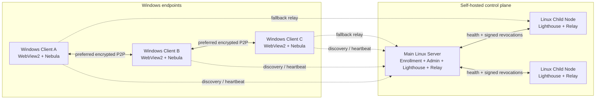

<div align="center">
  
  <h1>MeshLAN</h1>
  <p><strong>简体中文</strong> · <a href="README.en.md">English</a> · <a href="README.ja.md">日本語</a></p>
  <p><strong>以 P2P 为主、Relay 兜底的自托管虚拟局域网与本地服务协作平台</strong></p>
  <p>
    
    
    
    
    
  </p>
</div>

MeshLAN 在 [SlackHQ Nebula](https://github.com/slackhq/nebula) 之上提供自动配对、
P2P/NAT 优化、多 Lighthouse/Relay、服务映射、MeshDNS、文件直传、访问审批、
实时拓扑、历史回放、安全更新和可选 AI 自动化。Windows 用户只需运行一个便携
客户端；控制面和中继节点由你自己的 Linux 服务器承载。

> 本仓库包含 Windows 客户端、Linux 主控制服务器和 Linux 子节点的完整源码。
> 截图来自真实原生客户端，设备标识、IP、IPv6、域名和公网端点均已遮挡。

## 截图

### 实时网络拓扑


### 历史与回放


### AI 助手


## 核心能力

- **虚拟局域网**：基于 Nebula v2 证书和加密隧道连接异地 Windows 设备。
- **P2P 优先**：双栈打洞、稳定 UDP 端口、UPnP、STUN 诊断与 Route Guard。
- **Relay 兜底**：直连失败时自动中继；多节点根据延迟、抖动、丢包和健康状态择优。
- **多节点控制面**：主 Lighthouse 管理 Linux 子 Lighthouse/Relay，支持健康检查与故障切换。
- **服务映射**：把 `localhost` TCP/UDP 服务发布给同一 Mesh，支持自定义端口、暂停和健康检查。
- **访问审批**：服务可设置直接访问或手动批准；创建者只能管理自己的映射和授权。
- **MeshDNS**：设备使用 `alice.mesh`，服务使用 `api.alice.mesh` 等稳定名称。
- **HTTPS 网关**：为 `.mesh` HTTP 服务提供本地 CA、证书签发和无端口访问入口。
- **文件直传**：文件内容通过设备间加密链路传输，控制服务器只分发元数据。
- **实时可观测性**：拓扑、P2P/Relay 路径、Underlay、延迟、服务健康和实时字节动画。
- **按用户 Token 统计**：从模型响应的真实 `usage` 累计输入、输出、缓存与推理 Token，不读取对话正文。
- **历史与回放**：本地 SQLite 保留流量、路径、连接和事件；支持时间滑块与筛选。
- **AI 助手**：模型密钥只在服务端；上下文和结果端到端加密；所有修改必须由用户确认。
- **安全更新**：Ed25519 签名清单、SHA-256 校验、可选 Authenticode、健康检查和自动回滚。
- **多语言界面**：支持简体中文、繁體中文、English、日本語；界面与 AI 助手回复同步切换并在本机保存。

## 把异地设备变成一个局域网

MeshLAN 的核心不是把某一个 API 暴露到公网，而是让不同运营商、不同城市、不同 NAT
后的 Windows 设备加入同一个加密局域网。每台设备获得稳定的 Mesh IP，应用可以像访问
同一台路由器下的电脑一样访问其他设备；现有家庭网络、公司网络和默认网关不会被替换。

- 设备之间优先使用加密 P2P 直连，打洞失败才自动切换到可用 Relay；
- IPv4、IPv6 或智能双栈可按设备选择，Route Guard 避免全局代理/TUN 抢走 MeshLAN 链路；
- 拓扑图实时展示在线设备、实际 P2P/Relay 路径、延迟、流量和链路变化；
- 设备离线、换网或公网端点变化后会重新注册和建链，不需要重新分配 Mesh IP；
- 同一 Mesh 内可继续使用 ping、远程桌面、数据库、游戏服务器和自建 API 等现有协议。

```text
Windows A ── encrypted P2P ── Windows B
    │                              │
10.77.0.2                      10.77.0.3
    └──── Relay fallback（仅直连失败时）────┘
```

控制服务器负责设备授权、证书和发现信息，不承载正常的 P2P 业务数据。即使走 Relay，
中继看到的也只是 Nebula 加密数据包。

## MeshDNS：用名称访问设备和服务

Mesh IP 适合底层路由，人更适合记名称。MeshDNS 为每个用户/设备维护可修改的唯一前缀，
并根据当前设备和服务状态实时生成记录，无需在每台电脑上手写 `hosts` 文件。

假设设备前缀是 `alice`：

| 目标 | MeshDNS 名称 | 示例用途 |
|---|---|---|
| 设备本身 | `alice.mesh` | ping、RDP、SMB 或其他任意协议 |
| HTTP 服务 | `chat.alice.mesh` | 通过本地网关无端口访问 Web 服务 |
| 普通 TCP 服务 | `db.alice.mesh:5432` | 数据库、API 或自定义 TCP 协议 |
| UDP 服务 | `game.alice.mesh:27015` | 游戏服务器或其他 UDP 服务 |

用户可以修改自己的设备前缀，也可以为每个已发布服务单独修改三级前缀。创建、编辑、
暂停或删除映射后，服务目录与 MeshDNS 记录会随真实状态更新；名称冲突会在保存前提示，
不会静默指向错误设备。只有 HTTP/HTTPS 网关模式可以省略端口，普通 TCP/UDP 服务仍需
使用映射端口。

## 服务映射：共享 localhost，而不是暴露公网端口

很多开发工具只监听 `localhost`，例如本地 API、Web 面板、数据库或游戏服务器。
MeshLAN 可以把它发布到虚拟局域网，不需要在家庭路由器做端口转发，也不需要把服务
直接暴露给整个互联网。

创建映射时填写：

1. 服务名称，例如 `Chat API`；
2. 本地地址与端口，例如 `localhost` 和 `4571`；
3. TCP 或 UDP；
4. 自动分配或自定义 Mesh 端口；
5. MeshDNS 服务前缀，例如 `chat`；
6. 直接访问或需要创建者批准。

发布完成后，同一 Mesh 的成员会在“全网共享服务”中实时看到服务所有者、名称、协议、
健康状态、访问地址和端口。例如本机的 `localhost:4571` 可以发布为：

```text
http://chat.alice.mesh
# 或普通端口模式
chat.alice.mesh:20000
```

映射支持同时创建多个 TCP/UDP 服务。端口冲突会在创建前返回明确提示；创建者可以暂停
整个映射、暂停某个获准用户、查看当前连接者和流量，并随时恢复。需要审批的服务会生成
访问申请，创建者可在消息列表中同意或拒绝。所有用户都能查看共享目录，但只能修改或
删除自己创建的映射。

```text
peer request
    │
    ▼
chat.alice.mesh:20000
    │  MeshDNS + access policy
    ▼
alice (10.77.0.2)
    │  local encrypted forwarding
    ▼
localhost:4571
```

## 架构



### 组件

| 组件 | 平台 | 职责 |
|---|---|---|
| Windows Client | Windows 10/11 | 原生桌面窗口、配对、Nebula 服务、Route Guard、服务映射、MeshDNS、文件直传、AI 助手 |
| Main Server | Linux amd64/arm64 | 管理台、设备授权、证书签发、吊销、更新分发、主 Lighthouse/Relay、AI Provider |
| Child Node | Linux amd64/arm64 | 第二 Lighthouse/Relay、健康上报、吊销同步和多节点故障切换 |

数据流量尽可能直接在客户端之间传输。控制服务器不代理普通 P2P 业务；仅当直连不可用
并启用 Relay 时才转发 Nebula 加密数据包。

## 技术栈

| 层 | 技术 |
|---|---|
| 语言 | Go 1.26，少量 PowerShell、Bash、原生 JavaScript |
| Overlay | SlackHQ Nebula 1.11，Noise 握手，v2 证书，Lighthouse/Relay/Punchy |
| Windows UI | WebView2 原生窗口，嵌入式 HTML/CSS/JavaScript，无外部前端 CDN |
| 可视化 | SVG 拓扑、实时吞吐与历史双层曲线 |
| 持久化 | SQLite（WAL），JSON 状态，Windows DPAPI |
| 密码学 | TLS 1.3 pin、X25519、AES-256-GCM、Ed25519、SHA-256 |
| Windows 集成 | SCM、IP Helper API、WFP、计划任务、原生路由和证书库 |
| Linux 集成 | systemd、`LoadCredential`、文件权限与原子升级 |
| AI | OpenAI-compatible Chat Completions，SSE 流式输出，服务端工具白名单 |
| CI | GitHub Actions，Windows/Linux 测试、vet 和多平台构建 |

## 仓库结构

```text
.
├── cmd/meshlan/               # MeshLAN 可执行程序源码
│   ├── admin/                 # Linux 主服务端管理台
│   ├── assets/                # 图标与 Windows manifest
│   ├── deploy/                # Linux 子节点安装/升级和 systemd 配置
│   ├── web/                   # Windows 客户端 UI
│   ├── *_windows.go           # Windows 客户端与系统集成
│   ├── server.go              # 主服务端和管理 API
│   ├── node_agent.go          # Linux 子节点
│   ├── multinode.go           # 多 Lighthouse/Relay 管理
│   ├── ai_*.go                # AI 加密、流式调用、会话和工具执行
│   └── history.go             # SQLite 历史与采样
├── docs/                      # 文档与脱敏截图
├── tools/                     # 诊断脚本
├── build.ps1                  # 测试与跨平台构建
└── VERSION
```

## 快速开始

### 构建要求

- Go 1.26+
- Windows 10/11（构建和运行客户端）
- Microsoft Edge WebView2 Runtime
- Nebula 与 `nebula-cert` 1.11.x
- Linux 主机（运行主服务端和可选子节点）

### 构建全部组件

在 Windows PowerShell 中：

```powershell
git clone https://github.com/zhaoxuya520/MeshLAN.git
cd MeshLAN
.\build.ps1
```

输出位于 `dist/`：

```text
MeshLAN-Nebula-Windows.exe
meshlan-nebula-server-linux-amd64
meshlan-nebula-server-linux-arm64
meshlan-nebula-node-linux-amd64
meshlan-nebula-node-linux-arm64
SHA256SUMS.txt
```

也可以直接运行：

```powershell
go test ./...
go vet ./...
```

**没有 Windows 机器也能编译客户端**：`cmd/meshlan` 是纯 Go、默认 `CGO_ENABLED=0`，可直接在 Linux/macOS 交叉编译：

```bash
VERSION="$(cat VERSION)"
CGO_ENABLED=0 GOOS=windows GOARCH=amd64 go build -trimpath \
  -ldflags "-s -w -H=windowsgui -X main.clientVersion=meshlan-nebula/$VERSION" \
  -o dist/MeshLAN-Nebula-Windows.exe ./cmd/meshlan
```

产物是 PE32+ / amd64 / **GUI 子系统**（不是控制台程序），约 15 MB。

> **仓库没有发布任何 release**（只有 tag），`dist/` 也不入库。所以拿不到成品 exe 只能自己编：
> `build.ps1` 或 CI 的 artifact（Actions 里按 commit 下载，有过期时间）。

### 初始化主服务端

以下仅为示例；请替换公网地址、端口和文件路径：

```bash
sudo install -d -m 0700 /etc/meshlan-nebula
sudo install -m 0755 meshlan-nebula-server-linux-arm64 /usr/local/bin/meshlan-nebula
sudo install -d -m 0755 /dev/net
sudo mknod /dev/net/tun c 10 200 2>/dev/null || true

sudo /usr/local/bin/meshlan-nebula server init \
  -state /etc/meshlan-nebula/server-state.json \
  -endpoint 203.0.113.10:4242 \
  -subnet 10.77.0.0/24 \
  -nebula-port 4242 \
  -pairing-port 8443 \
  -nebula /usr/local/bin/nebula \
  -nebula-cert /usr/local/bin/nebula-cert
```

初始化命令只显示一次配对哈希和管理令牌。立即保存到密码管理器；不要写入仓库、Shell
历史、工单或日志聚合系统。随后使用 systemd 运行：

```bash
sudo /usr/local/bin/meshlan-nebula server serve \
  -state /etc/meshlan-nebula/server-state.json
```

需要放行：

- Nebula UDP 端口（示例 `4242/udp`）；
- 配对/管理 HTTPS 端口（示例 `8443/tcp`）。

运行期还要求：Nebula 要建 tun 设备，所以 `server serve` 必须以 root（或带
`CAP_NET_ADMIN`）运行，宿主机要有 `/dev/net/tun`；否则它在启动 Nebula 时
失败并直接退出。tun 设备名固定为 `meshlan-lh`（15 字节，正好是内核 `IFNAMSIZ-1` 上限）。

生产环境应使用反向代理、有效域名证书、最小化防火墙、专用 systemd 用户、
`LoadCredential` 和离线备份。示例 credential drop-in 位于
`cmd/meshlan/deploy/systemd/20-credentials.conf`。

### 运行 Windows 客户端

```powershell
.\dist\MeshLAN-Nebula-Windows.exe
```

客户端首次运行时输入：

1. 本机设备名称；
2. 主服务端公网 IP 或域名；
3. 服务端创建的 `MLN1...` 一次性授权哈希。

客户端在本机生成 Nebula 私钥，领取证书后安装 `Nebula` Windows 服务。关闭桌面窗口
不会断开虚拟网络。

#### 运行时目录（`nebula.exe` 放在哪）

**不要**把 `nebula.exe` 放到 `MeshLAN-Nebula-Windows.exe` 同级——位置是代码写死的，
与 exe 所在目录无关（`cmd/meshlan/client_windows.go:1970`）：

```text
%APPDATA%\MeshLANNebula\        ← appRoot()，即 os.UserConfigDir()/MeshLANNebula
├── client\                     ← 客户端状态，删了等于重置（需重新配对）
│   ├── client-state.json
│   ├── history.sqlite
│   ├── host.key / host.pub / host.crt / ca.crt   ← 配对后生成
│   ├── config.yml              ← 渲染出的 nebula 配置
│   └── (file-shares.json, shares\, updates\, apply-update.ps1, …)
├── native-webview2\EBWebView\  ← WebView2 缓存，可删，会自动重建
└── runtime\
    └── nebula-v1.11.0\         ← runtimeDir = root/runtime/nebula-v<版本>
        ├── nebula.exe          ← 必需
        ├── nebula-cert.exe     ← 必需
        └── dist\windows\wintun\
            └── bin\amd64\wintun.dll   ← 必需（nebula.exe 运行时加载）
```

`ensureNebulaRuntime` 的判据是**两个文件都齐**才跳过下载；只放 `nebula.exe` 仍会重新下载。

**首次运行需要访问 GitHub**：客户端会下载
`https://github.com/slackhq/nebula/releases/download/v1.11.0/nebula-windows-amd64.zip`
并校验 SHA-256（`dc6b144bd852b5a17fc0c9283d96e6309fd918c9e8f385fab256da6dfdd42232`）。
内网/代理环境若下不来，会报「Nebula 下载多次中断，请检查代理或网络」。

#### 离线部署（不联网的多台客户端）

在一台能上网的机器上下好官方 zip，校验后按上面的结构铺进去即可——文件已在，
客户端就跳过下载：

```powershell
# 1) 校验（必须与上面那个 SHA-256 一致，否则客户端拒绝使用）
Get-FileHash .\nebula-windows-amd64.zip -Algorithm SHA256

# 2) 铺到固定位置（Expand-Archive 会把 dist\ 一起解开，正合所需）
$dst = "$env:APPDATA\MeshLANNebula\runtime\nebula-v1.11.0"
New-Item -ItemType Directory -Force -Path $dst | Out-Null
Expand-Archive .\nebula-windows-amd64.zip -DestinationPath $dst -Force

# 3) 确认三件必需文件都在
Test-Path "$dst\nebula.exe"
Test-Path "$dst\nebula-cert.exe"
Test-Path "$dst\dist\windows\wintun\bin\amd64\wintun.dll"
```

`dist\windows\wintun\` 里其余架构（`arm/arm64/x86`）的 dll 与 `include\`、`README.md`、
`LICENSE.txt` 可以删除；**`bin\amd64\wintun.dll` 不能删**——它由 nebula.exe 在运行时
从自己所在目录加载。`native-webview2\EBWebView\` 是 Edge 内核缓存，不是程序文件，
随时可删（下次启动会重新生成）。


### 添加 Linux 子节点

首次安装：

```bash
export MESHLAN_RELEASE_BASE_URL=https://your-meshlan.example
curl -fsSL "$MESHLAN_RELEASE_BASE_URL/download/node/install.sh" -o /tmp/install-mesh-node.sh
sudo -E bash /tmp/install-mesh-node.sh \
  --endpoint 198.51.100.20 \
  --name edge-01
```

脚本输出 `MLNODE1...` 哈希。登录主服务端管理台，将子节点地址和哈希加入多节点页面。

原地升级：

```bash
export MESHLAN_RELEASE_BASE_URL=https://your-meshlan.example
curl -fsSL "$MESHLAN_RELEASE_BASE_URL/download/node/upgrade.sh" | sudo -E bash
```

升级脚本会校验 SHA-256、保留节点身份、重启健康检查，并在失败时回滚。

## 容器部署（Docker / Podman）

> 镜像在本地构建，**不向任何 registry 发布**。定义文件：`Dockerfile`、`docker-compose.yml`、
> `.dockerignore`、`docker/entrypoint.sh`。

一台镜像、一个容器一个角色（`lighthouse` / `node`）。**Relay 是 Lighthouse 的一种能力，不是第三个角色**，
所以 compose 里没有"relay 服务"。

```bash
# 公网地址必填，但**只填一个地址**即可：端口由入口按角色补
MESHLAN_IP=203.0.113.10 docker compose up -d --build
```

不想手敲变量就用引导脚本，它会问几个问题、写好 `.env`、建好状态目录、校验 compose 再启动：

```bash
docker/bootstrap.sh
```

首次启动会签发 CA、Lighthouse 证书与两套身份，随后拉起 Nebula。状态全部落在**绑定目录**
`./meshlan-state`（可用 `MESHLAN_STATE_DIR` 改）的 `/var/lib/meshlan`（Node 用同一目录内的
`/var/lib/meshlan/node`）。用绑定目录而不是命名卷，是为了让「备份 = 打包一个目录」成立。

**目录 = 身份 + 主密钥。删目录 = 重建整个 PKI，所有已配对设备永久失联。** 升级镜像只需
`docker compose up -d --build`，重建容器不会改变 CA 指纹、配对码与历史库。

### 首次启动

- 缺少 `MESHLAN_IP`（兼容写法 `MESHLAN_PUBLIC_ENDPOINT`）时容器立刻以非零码退出并打印一行可复制的
  命令，**不会**猜 localhost、也不会探测出口地址。
- 这个地址在初始化时被写进状态，仓库里没有修改命令：**填错了只能删状态目录重建 PKI**。
- 初始化只认"本角色状态文件是否存在"作为幂等判据；状态文件不在但已有 `ca.key` 一类的材料时，
  入口报"上次初始化未完成"并退出，不会静默重跑（`nebula-cert` 的 `ca`/`sign` 拒绝覆盖）。
- 只初始化、不启动服务：`MESHLAN_INIT_ONLY=1`。

### 一次性凭据

配对哈希与管理令牌（Node 是 `MLNODE1…`）只在初始化时打印一次，同时落一份到状态根下的
`first-credentials.txt`（`0600`，卷内，容器不会自动删除）：

```bash
docker compose exec lighthouse cat /var/lib/meshlan/first-credentials.txt
```

**初始化阶段的 stdout 不得接进持久日志系统**：`server init` 会先落明文 `ca.key`、随后才加密并删除，
那一小段输出可能带出私钥。compose 已给日志加了轮转，但这只降低暴露面、不替代这条口径。

需要重新生成时（旧值立即失效，已配对设备不受影响）：

```bash
docker compose exec lighthouse meshlan server admin-token -state /var/lib/meshlan/server-state.json
docker compose exec lighthouse meshlan server pairing -state /var/lib/meshlan/server-state.json
```

### 端口、能力与健康检查

| 角色 | 端口（宿主:容器，1:1） | 健康检查 |
| --- | --- | --- |
| Lighthouse | `8090/tcp`、`4242/udp` | `GET /v1/admin/auth-info`，要求 200 且 `Content-Type` 为 JSON |
| Node | `18090/tcp`、`14242/udp` | `GET /v1/node/health`，只要求 200 且 JSON 可解析 |

**端口一律 1:1，禁止端口翻译**：Node 对外宣称的 Nebula 端点与配对载荷里的控制端口都会被主控原样取用，
翻译映射会让主控连到错误的端口。

不需要 root、不需要 `privileged`，也不加载任何内核模块，但 Nebula 要两样东西：`/dev/net/tun` 设备节点
与 `NET_ADMIN` 能力。非 root 用户还需要二进制上的 file capability，入口会在启动前 `setcap` 并
`setpriv` 降权到 uid/gid 10001（状态目录首次出现时属主不是 10001，入口会先 `chown` 状态根；绑定目录时这会改宿主目录属主，属预期行为）。

**健康检查的盲区**：`healthy` 只说明控制面在监听，既不说明 Nebula 打通，也不说明能配对。探针走免认证
端点并对自签证书放行（`curl -k`），不验证证书链。

### 停止、备份与升级

- `stop_grace_period: 30s`。**不要对退出码断言**：容器 init 受内核 `SIGNAL_UNKILLABLE` 保护，
  SIGTERM 到不了服务进程，143/137 都不是判据；看到 137 应读作"宽限期不够"。理由见
  `docs/adr/0001-no-graceful-shutdown-in-container.md`。
- 备份是**冷备份**：停容器后直接打包状态目录（`tar czf`），必须连同 SQLite 的 WAL 附属文件一起——整目录打包天然满足。
- 外部主密钥（可选进阶）：`MESHLAN_MASTER_KEY_FILE` 指向平台 secret 后，**每条子命令都必须同时
  显式带 `-state`**，否则命令会找错默认路径、读不到主密钥。容器里的子命令用法：

```bash
docker compose exec lighthouse meshlan server list -state /var/lib/meshlan/server-state.json
```

### Node 角色

```bash
# Node 的地址缺省复用 MESHLAN_IP；要区分就设 MESHLAN_NODE_IP
MESHLAN_IP=203.0.113.10 MESHLAN_NODE_IP=198.51.100.20 \
  docker compose --profile node up -d --build
```

Node 的 profile 名固定为 `node`。它和 Lighthouse 共用同一个状态目录，但身份存放在子目录里。
用 `docker/bootstrap.sh --with-node` 起的话，脚本会**自己把 Node 加进主控并验证配对**；手工做法是
取 `first-credentials.txt` 里的 `MLNODE1…` 哈希，在管理台「多节点」页填入，或用部署手册 5.1 的纯
API 命令。把
`first-credentials.txt` 里的 `MLNODE1…` 哈希填到 Lighthouse 管理台的多节点页面即可。

同主机部署时，主控要连到 Node 发布的 `18090/tcp`：compose 服务名只在同一 compose 网络内可解析，
给 Lighthouse 加 `extra_hosts: {host.docker.internal: host-gateway}` 再用它当 `endpoint` 提交。

### 反向代理与 SSO

把 MeshLAN 放到 Traefik 后面、并用 Authentik 管管理台时，有两条**不能违反**的约束：

1. **Traefik 只能 TCP 透传，不能终止 TLS。** 设备按 sha256 **指纹钉死**控制面证书
   （`pinnedTLSConfig`，且要求链上恰好一张证书），换证书的中间层会让所有已配对设备同时掉线。
2. **Authentik 只能保护 `/admin`，不能保护 `/v1/*`。** 设备与节点 API 是机器对机器，
   凭 `Authorization` 头而非 cookie；被 SSO 拦会 302 到登录页，配对与心跳全线失败。
   一个端口同时服务管理台与 API，所以必须在代理层按路径拆路由。

完整步骤（含动态配置示例、Authentik provider 配置、路径白名单、故障排查）见
[`docs/deployment-docker-traefik-authentik.md`](docs/deployment-docker-traefik-authentik.md)，
决策理由见 [`docs/adr/0003-tls-passthrough-and-sso-boundary.md`](docs/adr/0003-tls-passthrough-and-sso-boundary.md)。

### 验收脚本

```bash
docker/acceptance.sh
```

一条命令覆盖构建 → 配置校验 → 双 profile 健康 → 身份跨 restart 与 `--force-recreate` 不变 →
四条 fail-fast → `MESHLAN_INIT_ONLY` → Node 起得来 → **Node 真配对**，结束自清理。它用独立项目名
`meshlan-acceptance` 并在开跑前探测端口与同名栈，**不要在跑着真实部署的机器上直接跑**。

### Container usage (English)

One image, one role per container (`MESHLAN_ROLE=lighthouse|node`); Relay is a Lighthouse capability,
not a role. The image is built locally and **never pushed to a registry**. Only one address is required
at first start (`MESHLAN_IP=203.0.113.10`; the entrypoint appends the port per role) and it cannot be
changed afterwards without recreating the PKI. State lives in the bind mount `./meshlan-state`
(`/var/lib/meshlan`, Node in `/var/lib/meshlan/node`); **deleting that directory rebuilds the whole PKI**.
Run `docker/bootstrap.sh` for an interactive setup that writes `.env` and prepares the directory.
Ports are mapped 1:1 (Lighthouse `8090/tcp` + `4242/udp`, Node
`18090/tcp` + `14242/udp`) because Node advertises exactly those ports. The container needs
`/dev/net/tun` and `NET_ADMIN`; the entrypoint chowns the state root, sets the file capability, drops to
uid 10001 and execs the server as PID 1 (no signal proxy, no exit-code assertions). A green health
check means the control plane answers — not that Nebula is up, and not that pairing works.

## AI 助手

AI 是可选功能。管理员可配置任意 OpenAI-compatible HTTPS 地址和模型。模型 API 密钥
只保存在主服务器的加密状态中，不下发客户端。

客户端与服务端使用 X25519 派生会话密钥，并以 AES-256-GCM 加密每次请求、流式增量和
最终计划。AI 只能调用白名单工具；任何修改操作都必须先在客户端展示计划，并由用户
明确确认。软件展示可审计工作摘要，不展示或声称提供模型隐藏思维链。

## 安全设计

- 设备私钥在端点生成，不上传控制服务器。
- 一次性授权哈希绑定设备名称和公钥。
- 服务端 CA、TLS、签名、TOTP 与 AI 密钥使用 AES-256-GCM envelope 保存。
- Windows 设备令牌使用当前用户 DPAPI。
- 吊销列表和更新清单由独立 Ed25519 密钥签名。
- Route Guard 脚本安装到受保护目录，并在高权限写入前验证固定 SHA-256。
- 管理台使用短会话，可启用 TOTP。
- 更新包校验签名、长度和 SHA-256；失败或健康检查超时自动回滚。
- 本机管理 API 仅监听 `127.0.0.1`。

请阅读 [SECURITY.md](SECURITY.md)。自托管并不等于自动安全：公网端口、防火墙、系统
更新、管理员终端、备份和代码签名仍由部署者负责。

## 隐私

- 普通 P2P 业务不经过控制服务器。
- Relay 只转发 Nebula 加密数据包。
- 文件内容不上传控制面。
- 历史数据库保存在本机，默认保留 30 天。
- 服务连接历史不记录报文内容。
- 故障报告和截图应在提交前移除地址、域名、令牌和个人身份信息。

## 参与贡献

请阅读 [CONTRIBUTING.md](CONTRIBUTING.md)。欢迎提交：

- Windows/IPv6/NAT 兼容性修复；
- 多 Relay 质量策略；
- Linux 服务部署与容器化；
- 可访问性、国际化和文档；
- 安全审计和回归测试。

## 许可证

[MIT License](LICENSE)

## 致谢

- [SlackHQ Nebula](https://github.com/slackhq/nebula)
- [WebView2](https://developer.microsoft.com/microsoft-edge/webview2/)
- [modernc.org/sqlite](https://pkg.go.dev/modernc.org/sqlite)
